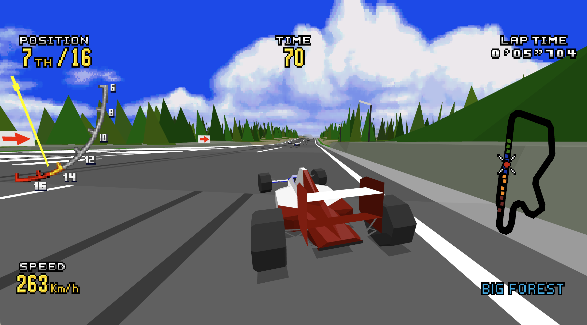
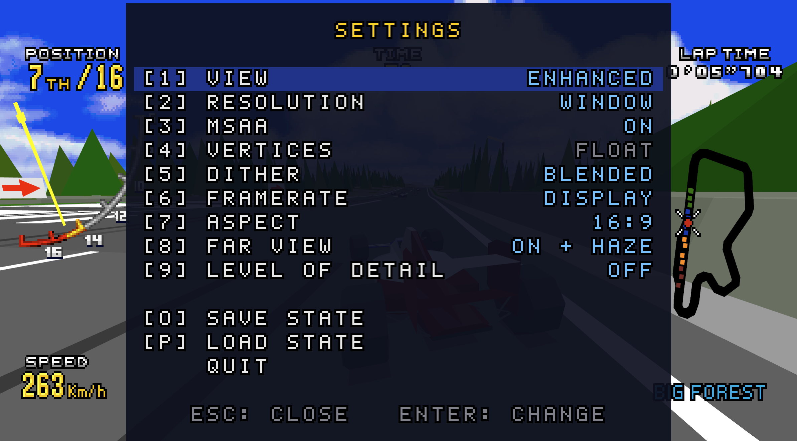

# Virtua Racing Deluxe Enhanced

[English](README.md) | 繁體中文

此專案以 PicoDrive 模擬器為基礎，運行原版 Sega 32X《Virtua Racing Deluxe》並強化畫面。

> **此為非官方專案**，與 SEGA 無關也無認可。Virtua Racing 是 SEGA 的商標。本專案不包含 ROM 或任何從 ROM 取出的資料。僅限非商業用途。

## 特色

透過高階模擬（High-Level Emulation，HLE），截取 68000 CPU 傳送給 32X SH2 處理器的資料，並且改由 GPU 重建 3D 場景與繪製。

- **解析度**：可調整繪製解析度，並可開啟 MSAA。
- **FPS**：突破原本 20 FPS 的限制，畫面動態更流暢。
- **寬螢幕**：可選擇原本 4:3 或者強化版 16:9。
- **可視距離**：看得更遠，減少場景物件突然出現的情形。
- **內建選單**：可隨時調整強化項目。
- **類比操作**：支援類比轉向、油門與煞車。

<p align="center">
  
  
</p>
<p align="center">左：強化後的畫面。右：設定選單。</p>

<p align="center">
  <a href="https://youtu.be/Qz6ry8pjurQ"></a>
</p>
<p align="center">YouTube 影片（點擊播放）。</p>

## ROM

本專案**不提供**任何 ROM。

目前支援的版本：

| 項目 | 值 |
|---|---|
| 版本 | Virtua Racing Deluxe (USA) |
| SHA-1 | `18dfdeb50780c2623e60a6587d7ed701a1cf81f1` |
| CRC32 | `7896b62e` |

## 啟動遊戲

請至 Releases 下載已編譯好的版本，再準備好自己的 ROM。
若對預先編譯的執行檔有疑慮，也可以自行從原始碼編譯。編譯步驟請參考 [how-to-build.md](docs/how-to-build.md)（英文）。

### macOS

- 需搭載 Apple Silicon（M1 以後晶片）的 Mac。
- 需要先用 [Homebrew](https://brew.sh) 安裝 SDL2：`brew install sdl2`
- 在終端機裡，到 `vrde` 所在的資料夾執行：

  ```sh
  ./vrde "Virtua Racing Deluxe (USA).32x"
  ```

- 程式沒有數位簽章，macOS 可能會顯示「無法驗證開發者」而擋下來。到「系統設定 → 隱私權與安全性」，選擇「強制打開」即可。

### Windows

- 需要 64 位元的 Windows 10 以上。
- `vrde.exe` 和 `SDL2.dll` 放在同一個資料夾，把 ROM 檔拖到 `vrde.exe` 上就會啟動。
- 程式沒有數位簽章，第一次執行時可能會被擋下，可選擇「其他資訊」→「仍要執行」來強制開啟遊戲。

### Linux

已附 Makefile，編譯方式請參考 [how-to-build.md](docs/how-to-build.md)（英文）。

## 操作

| 按鍵 | 功能 |
|---|---|
| 方向鍵 | 方向 |
| A / S / D | 手把的 A / B / C（比賽中 B 為油門） |
| Z / X / C | 六鍵手把的 X / Y / Z（比賽中切換視角） |
| F | Start |
| 1 | 切換檢視：強化版（預設）／原版／左右並排（原版 \| 強化版） |
| 2 | 切換解析度：視窗解析度（預設）／1 倍／2 倍／4 倍 |
| 3 | 切換 MSAA：開啟（預設）／關閉 |
| 4 | 切換頂點資訊：浮點數（預設）／原版整數 |
| 5 | 切換網點：混合（預設）／原版的網點 |
| 6 | 切換 FPS：20 FPS／30 FPS／40 FPS／60 FPS／顯示器更新率（預設） |
| 7 | 切換畫面比例：16:9（預設）／21:9／自動（視窗長寬比，上限 32:9）／原版的 4:3 |
| 8 | 切換遠景：遠景加霧（預設）／遠景／原版 |
| 9 | 切換 Level of detail：關閉（預設）／開啟（遠處的對手車改用簡化模型，和原版相同） |
| O | 存檔：儲存目前狀態至 `vrde.mds`（僅有一個存檔槽，會覆蓋先前的存檔） |
| P | 讀檔：從 `vrde.mds` 讀回狀態 |
| Esc | 開啟選單：遊戲暫停，可用方向鍵和 Enter 調整設定、切換全螢幕、存檔、讀檔或離開，再按 Esc 關閉 |
| Alt+Enter | 切換全螢幕（無邊框，使用桌面的解析度；下次啟動時沿用） |

設定也可透過修改 vrde.ini 來手動更新。

支援 Xbox、PlayStation、Switch Pro，以及其他 SDL 支援的手把。

主要按鍵依實體位置對應 Mega Drive 六鍵手把：左、下、右側按鍵分別對應 A、B、C，上方按鍵對應 Z。

| Xbox | PlayStation | Switch Pro | 對應 |
|---|---|---|---|
| 十字鍵 | 同左 | 同左 | 方向 |
| 左類比搖桿 | 同左 | 同左 | 方向；類比轉向 |
| X（左） | □ | Y | 手把的 A |
| A（下） | ✕ | B | 手把的 B |
| 左 trigger | L2 | ZL | 類比煞車 |
| 右 trigger | R2 | ZR | 類比油門 |
| B（右） | ○ | A | 手把的 C |
| LB、RB | L1、R1 | L、R | 六鍵手把的 X、Y |
| Y（上） | △ | X | 六鍵手把的 Z |
| Start | Options | + | Start |
| Back（或 Guide） | Share／Create（或 PS） | −（或 Home） | 打開選單 |
| 同時按下兩個搖桿（L3＋R3） | 同左 | 同左 | 顯示或隱藏除錯資訊（FPS、解析度、類比輸入） |

選單中，不論使用哪一種手把，右側按鍵變更選取的設定，下方按鍵關閉選單。

## 目錄

| 路徑 | 內容 |
|---|---|
| `src/` | 本專案的程式碼 |
| `tools/` | 研究工具：SH2 反組譯器、從 SH2 記憶體存取紀錄重畫多邊形、圖層拆解 |
| `docs/` | 編譯說明（英文） |
| `third_party/picodrive/` | PicoDrive。修改處均有標示 `VRDE:` |

## 引用參考與感謝

- **notaz** 和 **irixxxx**：[PicoDrive](https://github.com/irixxxx/picodrive)。
- **matiaszanolli**：[sega-vr-disasm](https://github.com/matiaszanolli/sega-vr-disasm)，本遊戲的反組譯，作為參考資料。
- FAME Motorola 68000 Emulation Library by Oscar Orallo (oscar@m68k.com).
- CZ80 由 Stéphane Dallongeville 撰寫；SH2 核心來自 MAME。
- AI 輔助開發。

## 授權

本專案自己的程式碼和文件採用 [LICENSE](LICENSE) 的條款：僅限非商業用途，條件和 PicoDrive 相同。

## 第三方授權

本專案包含取自 [PicoDrive](https://github.com/irixxxx/picodrive)
commit `8b5e91bc92c02a838188da410ccd82f79424ad6a` 的程式碼，
位於 `third_party/picodrive/`。

PicoDrive 採非商業授權。
完整條款請參閱 `third_party/picodrive/COPYING`。
其中的元件（FAME 68000 核心、CZ80、取自 MAME 的 SH2 直譯器等）沿用各自的條款。

散布或修改上述元件時，須遵守各自的授權條款。
